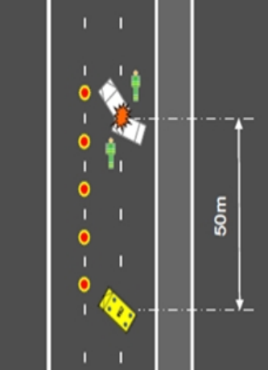

---
tags:
  - nog-niet-begonnen
---
📅 Aangemaakt: 23-11-2026

> [!info] Bronnen
> [PRESENTATIE Gevaarlijke stoffen](https://extranet.paulo.be)
> [PRESENTATIE Astrid](https://extranet.paulo.be)
> [LESNOTA'S van hoofdstuk](https://drive.google.com/file/d/10p908VUEzOjhFqvY_JtSmC2GTbsay-Yv/view?usp=sharing)

> [!check] Doelstellingen
> Geen concrete doelstellingen

>[!help] Gebonden praktijklessen
> - `17/10/2026` - [[../Praktijknota's/17-10-2026|PRAKTIJK BIOW, gevaarlijke stoffen & radiocommunicatie]]

>[!note] PDF: [[pdf link]]

# BIOW, Gevaarlijke producten en radioverbinding
---
## BIOW 
*(= Bescherming Interventies op de Openbare Weg)*

Voor vertrek: PBMs *(indien ontzetting -> lange mouwen AAN!)*

**Onderweg naar/van incident**:
1. Veilige aanrijroute
2. Gordel aan! - ook die van patiënt *(soms uitzondering voor patiënt indien echt niet mogelijk / meer minder- dan meerwaarde)*

**Multigroep**: Radiokanaal/inzetting met meerdere disciplines

Eens aangekomen
1. Wielen schuin zetten of indien meerdere rijstroken **(fend-off)**, volledig voertuig scheef *(maar dan wielen recht)* -> Doel is om voertuig bij aanrijding weg te laten bollen van incident
2. Parken van voertuig doe je 50m **stroomopwaarts**, indien eerste
3. Uitstappen en beide richtingen kijken, schouder aan schouder *(wel omgedraait)* met je collega hulpverlener -> NOOIT JE RUG KEREN NAAR HET VERKEER!

50 meter = twee verlichtingspalen

**Bij collectieve bescherming** *(klapborden v/ brandweer / FAST teams en beschermingsbarrieres + kegels en mogelijke andere signa)* -> Lichten van hulpverleningsvoertuigen traag uit

---
## Gevaarlijke stoffen
Bij herkennen gevaarlijke stoffen -> STOP!
1. Vergaar info
2. Aansturen van diensten

**ADR**: Akkoord gevaarlijk stoffen op de baan
**SEVESO**: een onderneming die grote hoeveelheden gevaarlijke stoffen produceert, verwerkt, behandelt, gebruikt of opslaat

**Waar**? Schoollaboratoria, thuis, bedrijven, ...
Alles dat je "te veel" opneemt kan schadelijk zijn, al is de grens lager bij sommige middelen

Grootste gevaren van gevaarlijke stoffen -> Explosies en inhallatie

Twee soorten besmetting: 
1. Primair: Jij bent degene in contact
2. Secundair: Je bent besmet door iemand *(meest waarschijnlijke in de hulpverlening)*µ

In water oplosbare middel? -> Decontaminatie met water, indien niet oplosbaar; water + zeep *(of indien procedure van bedrijf; die volgen)*
- Chemische bedrijven hebben eigen procedures

Treat first what kills first -> Alarmeren indien nodgi *(bv. in het gelaat -> MUG, blijkt grote lek -> brandweer)*

Hou rekening met:
1. Windrichting *(inhallatie!)*
2. Hoogteverschillen tussen jou en plaats interventie *(ook voor wolken)*
3. Nooit gas/dampwolken binnenrijden
4. Nooit in vloeistoffen staan
5. Ruiten gesloten houden
6. Afstand tot rode zone:
	- 50m: indien product gekend en veilig *(voor die afstand)*
	- 100m: geen zekerheid van product
	- 500m: kans op krachtige explosie

==Bij gevaar, terugtrekken!==

Neem foto's van incident bij gevaarlijke stoffen -> Containers, labels, kleur van vloeistof, wonden, ...

GHS: Globaal systeem voor gevaren aan te duiden 

GEVI: Identificatiecode van stof + gevaar

**CBRNE**: Speciale tak leger/civiele die gevaarlijke situaties beoordeelt en onschadelijk maakt

---
## Radioverbinding
ASTRID *(= All-arround Semicellular Trunking Radio netwerk with Integrated Dispatching)*
- Gebasseerd op TeTRa *(= terrestrial trunking radionetwork)*

**ASTRID** -> Netwerk en naam v/ associatie
Abbonement ASTRID bestaat uit:
1. **GSSI**: Group Short Subscriber Identity -> Per discipline *(bij DGH start met 6)*
2. **ISSI** Individual Short Subscriber Identity -> Per terminal/client *(individueel per radio)*

`*#06#` -> Zichtbaar maken GSSI en ISSI

Uitvoeringen van ASTRID terminals:
• Een vast apparaat *(écht een radio die permanent staat)*;
• Een mobiel apparaat *(de bak in de ambulance)*;
• Een draagbaar apparaat *(de radio die je meeneemt)*;
• Een mobiele gegevensterminal *(terminal waar je je XML toegestuurd in krijg)*;
• Een draagbare gegevensterminal *(meestal n.v.t.)*

Radio heeft *(nu)* ongeveer 300 gespreksgroepen, opgedeeld in mappen:
1. Per provincie
2. Standaard interprovinciale + zelf geprogrammeerde
3. map 3/4/5 -> lucht, grond & zee *(niet voor ons)*

Altijd provincie vernoemen bij vragen voor veranderen naar gespreksgroep -> OVL-OEF-06 =/= OEF-06 *(bij een andere provincie is dit bv. WVL-OEF-06)*

Statuscodes:
1. Bevestiging ontvangst bericht
2. Vertrokken voor opdracht
3. Aankomst ter plaatse van interventie
4. Vertrek naar ziekenhuis -> Radiofonische status doorgeven, wordt niet via cijfertoets ingedrukt
5. Aankomst in ziekenhuis van bestemming
6. Terug naar standplaats
7. Telefonisch beschikbaar op standplaats
8. Enkel beschikbaar indien nood -> Enkel radiofonisch doorgeven *(bv. indien ambulance volledig vuil is, kledij moet gewisseld worden, ...)*
	- Maak dat je je dan weer beschikbaar zet *(07)*

Cijfer per cijfer zeggen, NATO alfabet -> Te kennen!

SITREP gebeurt via METHANE principe *(niet te kennen, wel enorm handig)*

Radiodiscipline:
1. Bereid je voor
2. Kort & Duidelijk
3. Wees kalm
4. Traag en gearticuleerd
5. Beschaafd en beheerst
6. Hou microfoon dichtbij mond, maar met wat afstand
7. Lichtje groen -> Er is verbinding met het netwerk

---
